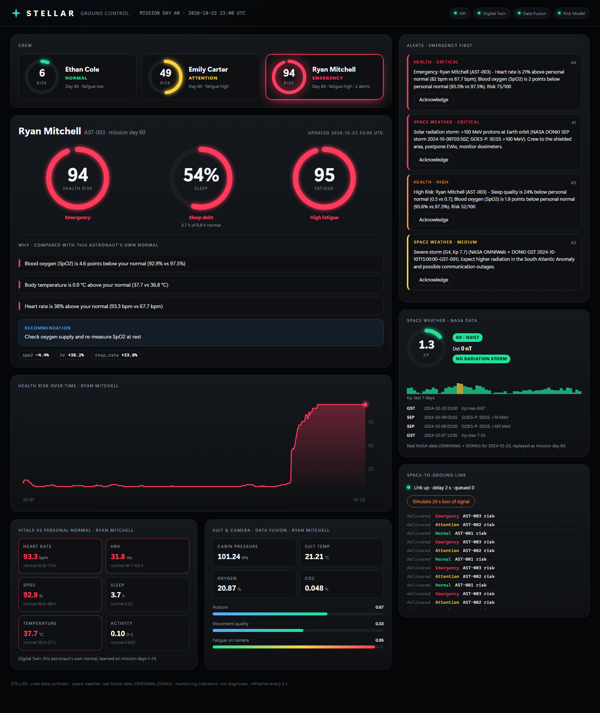
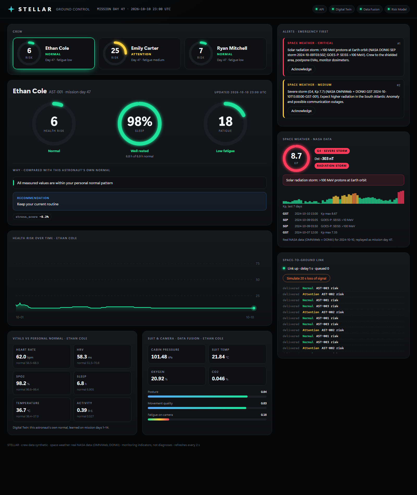

# STELLAR - every astronaut's health, in one place

> NASA Space Apps Challenge prototype: a personal digital twin for astronaut health.

In space the body's "normal" changes, so one fixed threshold for everyone either misses warnings or raises
false alarms. STELLAR learns **each astronaut's own normal**, fuses wearable, suit and camera data, scores
health risk from 0 to 100, explains every change in **plain language**, and runs **fully offline** next
to the crew. When the link to Earth drops, emergencies are sent first. The mission also replays **real NASA
space-weather data** (OMNIWeb, DONKI), so a real solar radiation storm sends the crew to shelter.



| Risk score | Level | Meaning |
|---|---|---|
| 0 - 24 | Normal | stable |
| 25 - 49 | Attention | needs follow-up |
| 50 - 74 | High Risk | alert to the crew |
| 75 - 100 | Emergency | immediate alert to Ground Control |

## Run it (Windows, one double-click)

1. Install **Python 3.11 or newer** from https://www.python.org/downloads/ and tick **"Add python.exe to PATH"**.
2. On this page click **Code > Download ZIP**. Before extracting: right-click the zip > **Properties** >
   tick **Unblock** > OK. Extract it.
3. Double-click **`START_PROTOTYPE.bat`**.
   - The first start installs the libraries (needs internet once, about 3 minutes). After that it runs offline.
   - The browser opens STELLAR Ground Control at http://127.0.0.1:8000/dashboard
   - A second window streams three astronauts' data live (mission days 45-60, about 3 minutes).
4. To stop: close the windows "STELLAR - Server" and "STELLAR - Live data".

Step by step: [HOW_TO_RUN.txt](HOW_TO_RUN.txt).

**macOS / Linux:** `./scripts/run_local.sh`, then in a second terminal
`python scripts/replay.py --start-day 45 --every-hours 6 --interval 0.3`, and open http://127.0.0.1:8000/dashboard

**Docker:** `docker compose up --build`

## What you will see

- **Ethan Cole** (AST-001) stays green (Normal) the whole time.
- **Emily Carter** (AST-002) slowly turns yellow (Attention): less sleep and a higher heart rate than *her* normal.
- **Ryan Mitchell** (AST-003) is normal until day 55. On day 56 at 06:00 he gets an early warning (High Risk), and at 16:00 an
  Emergency alert. His heart rate never crosses 100 bpm, so a fixed alarm would have stayed silent.
- Click an astronaut: health risk, sleep and fatigue rings, the reasons, the recommendation, current vitals
  against the personal normal (out-of-range values in red), suit and camera data, and the risk over time.
- Press **Simulate 20 s loss of signal**: when the link returns, emergencies are delivered first.

## NASA data: real space weather on the mission timeline

Mission days 1-60 replay the real space weather of **25 August - 23 October 2024** (solar maximum):

| NASA dataset | Used for | In the repo |
|---|---|---|
| [NASA OMNIWeb](https://spdf.gsfc.nasa.gov/pub/data/omni/low_res_omni/) (GSFC Space Physics Data Facility), OMNI2 hourly | Kp and Dst every hour | `data/nasa/omni_kp_dst_hourly.csv` |
| [NASA DONKI](https://ccmc.gsfc.nasa.gov/tools/DONKI/) (CCMC), solar energetic particles | radiation storms measured by GOES at Earth orbit | `data/nasa/donki_sep.json` |
| NASA DONKI via [api.nasa.gov](https://api.nasa.gov/), geomagnetic storms | storm start and Kp maximum | `data/nasa/donki_gst.json` |

- **Mission day 46** = 9 October 2024: a real radiation storm (>100 MeV protons at Earth orbit) -> one crew-wide
  alert: move to the shielded area, postpone spacewalks.
- **Mission day 47** = 10 October 2024: a real severe geomagnetic storm (G4, Kp 8.7; Dst down to -333 nT early on 11 October) -> alert.
- The dashboard's **Space weather · NASA data** panel shows Kp, Dst, the storm level, the radiation status, 7 days
  of Kp and the latest NASA events. `scripts/fetch_nasa_space_weather.py` downloads the data
  again from NASA. Radiation is one of NASA's five hazards of human spaceflight.



## How it works

```
Wearable + Suit + Camera --> POST /health-data
                             |- Digital Twin: personal baseline + deviation             (AI 1, Shimaa)
                             |- Data Fusion: one health vector, fatigue, cabin limits   (AI 3, Mariam)
                             |- Risk model: Random Forest + Isolation Forest + NEWS     (AI 2, Menna)
                             |- Plain-language explanation
                             |- Store + alert (Emergency first)                         (Backend, Ghandor)
                             |- NASA space weather at this mission hour (OMNIWeb + DONKI)
                             '- Space-to-ground queue (delay, loss of signal, priority)
```

The camera part: Mariam's MediaPipe Pose analysis turns an exercise video into posture, movement quality and
fatigue scores. See her overlay video:
[team_sources/ai3_cv_fusion_mariam/outputs/overlay_output.mp4](team_sources/ai3_cv_fusion_mariam/outputs/overlay_output.mp4).

## Repository layout

| Folder | What is inside |
|---|---|
| `app/` | the STELLAR server: API, database models, AI pipeline, alerts, space-to-ground link, NASA space weather |
| `app/static/dashboard.html` | the STELLAR Ground Control dashboard (the user interface, served by the app) |
| `ai_modules/` | the three AI modules, each with a small connector ([README](ai_modules/README.md)) |
| `data/scenarios/` | the demo crew data (synthetic, from the Digital Twin) |
| `data/nasa/` | the real NASA space-weather data ([README](data/nasa/README.md)) |
| `scripts/` | one-click start, local run, live replay, NASA data download |
| `tests/` | automated tests |
| `docs/` | technical guide ([TECHNICAL.md](docs/TECHNICAL.md)), API contract, ERD, architecture research, demo plan |
| `team_sources/ai1_digital_twin_shimaa/` | Digital Twin: personal baselines, synthetic crew data, notebooks, figures, tests |
| `team_sources/ai2_risk_model_menna/` | Risk model: training, evaluation report, plots, tests |
| `team_sources/ai3_cv_fusion_mariam/` | Computer vision + data fusion: MediaPipe pose analysis, suit simulator, fusion layer, sample and overlay videos, tests |

Each AI module is used by the app unmodified, through a small connector in `ai_modules/`.
Team modules keep their original internal package names, and their own files use the team's working names
for the same three astronauts: Ahmed = Ethan Cole (AST-001), Sara = Emily Carter (AST-002), Omar = Ryan Mitchell (AST-003).

## Tests

| Part | Command | Tests |
|---|---|---|
| STELLAR app + integration + NASA data | `python -m pytest` | 78 |
| Digital Twin | `cd team_sources/ai1_digital_twin_shimaa && python -m pytest` | 124 |
| Risk model | `cd team_sources/ai2_risk_model_menna && python -m pytest test_v11.py` | 8 |
| CV + fusion | `cd team_sources/ai3_cv_fusion_mariam && pip install -r requirements.txt && python test_fusion.py` | 13 |

## Team

| Member | Role |
|---|---|
| Abdelrahman Elghandour | Backend Lead: API, database, integration, Ground Control dashboard, demo |
| Alshimaa Elbhay | AI 1: Digital Twin (personal baselines, synthetic crew data) |
| Menna Alashqar | AI 2: Risk Prediction (hybrid risk model) |
| Mariam Dagher | AI 3: Computer Vision and Data Fusion |
| Marawan Soliman | Security and Ground Control web |
| Lina Alnawawy | Mobile app and user experience |

## Data and sources

The space weather is **real NASA data** (above). All crew data is **synthetic**, generated by the team's code (fixed seed, same result every time). Ranges and
trends were chosen from NASA and scientific publications, listed in
[team_sources/ai1_digital_twin_shimaa/docs/research_summary.md](team_sources/ai1_digital_twin_shimaa/docs/research_summary.md)
and [docs/ARCHITECTURE_RESEARCH.md](docs/ARCHITECTURE_RESEARCH.md).
In the live demo, suit telemetry (Mariam's simulator) and the daily camera check are simulated on the same
timestamps as the crew data. Outputs are monitoring indicators, **not medical diagnoses**.

Built with Python, FastAPI, SQLAlchemy, Alembic, Pydantic, PostgreSQL / SQLite, Docker, scikit-learn, NumPy,
pandas, SciPy, MediaPipe, OpenCV and pytest.

## Use of AI tools

Parts of this project's code, tests and documentation were written or reviewed with the help of an AI
assistant (Claude, Anthropic), under the team's direction and review. All crew data is synthetic and was
generated by the team's own code. Any AI-generated image or video in the presentation carries a visible
"AI-generated" watermark.

## Limits

- Results come from simulated data; real-world accuracy needs real wearable, suit and camera data.
- Demo accounts and secrets are for local development only (see `.env.example`).
