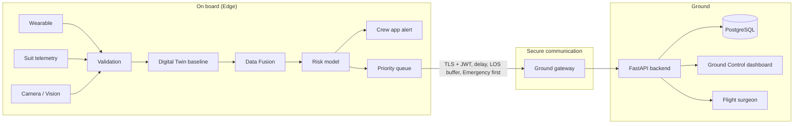

# Research 4 + 2 — Space computing architecture & current NASA systems

*STELLAR · Backend Lead (Ghandor) · week-1 research summary (due day 3).*
*Goal: justify an **Edge → Secure Comm → Backend → Apps** architecture to the jury.*

> Draft written for the team. Before submission, open each source in the list at the
> end and confirm the figures quoted (they are widely published, but verify the exact
> wording/page you cite).

## 1. The problem in one paragraph

Astronaut health is threatened by what NASA's Human Research Program groups as five
hazards — **R**adiation, **I**solation & confinement, **D**istance from Earth,
**G**ravity changes and hostile/closed **E**nvironments ("RIDGE"). Distance is the one that
shapes the software: the further from Earth, the longer the communication delay and the
less the crew can rely on doctors on the ground. A health system for long missions must
therefore **detect problems on board**, act locally, and send the right information to
Earth in the right order.

## 2. Communication delay & loss of signal

| Destination | One-way signal delay | Consequence |
|---|---|---|
| ISS (low Earth orbit) | well under a second via relay satellites | near-real-time support, but periodic loss-of-signal gaps |
| Moon | ≈ 1.3 s | conversation possible, slightly delayed |
| Mars | ≈ 3 – 22 min (depends on planet positions) | no real-time medical support; ~2-week blackouts around solar conjunction |

- The ISS talks to Mission Control mainly through NASA's **Tracking and Data Relay
  Satellite (TDRS)** network. Coverage is high but not continuous; data is buffered during gaps.
- For deep space NASA has tested **Delay/Disruption-Tolerant Networking (DTN)**, a
  store-and-forward approach ("bundle protocol") that keeps data until the next hop is
  reachable — including experiments on the ISS.
- **Implication for us:** the link is slow, sometimes down and limited in bandwidth, so
  messages need **priorities**. An Emergency must not wait behind hours of routine data.
  → implemented as the **Emergency Priority Queue** with simulated delay and blackout
  (`app/services/comm_link.py`, `GET /comm/status`, `POST /comm/blackout`).

## 3. Edge computing — why process close to the astronaut

1. **Latency:** a 20-minute round trip to Earth is too slow for an emergency (falling SpO2, arrhythmia).
2. **Autonomy:** NASA's direction for exploration medicine is **Earth-Independent Medical
   Operations** — the crew must be able to detect and manage problems without the ground.
3. **Bandwidth:** sending raw high-rate sensor streams (ECG, video) to Earth is expensive;
   sending a fused vector, a risk score and the reasons is cheap.
4. **Resilience:** if the link is down, local monitoring and crew alerts keep working.

What runs on the edge in STELLAR: validation, personal baseline comparison
(Digital Twin), data fusion, risk scoring, local alert to the crew app.
What goes to the ground: risk scores, alerts (Emergency first), summaries, history for
doctors; raw data later, when bandwidth allows.

## 4. Current medical monitoring on the ISS (Research 2)

- **Crew Health Care System (CHeCS):** the ISS medical system — medical kits, monitoring
  equipment, exercise countermeasures and environmental monitoring.
- **Bio-Monitor (Canadian Space Agency):** a smart shirt (Astroskin) with headband that
  records ECG, breathing, SpO2, skin temperature, blood pressure and activity — the same
  kind of signals our wearable layer simulates.
- **Ground flight surgeons** follow each crew member through scheduled private medical
  conferences and periodic exams; ultrasound and other exams can be guided remotely.
- **Long-term data:** NASA keeps longitudinal astronaut health records (Lifetime
  Surveillance of Astronaut Health) — the idea behind our **personal baseline**: compare
  each astronaut to *their own* normal, not to population averages.
- **Environment telemetry:** cabin pressure, O2 and CO2 are monitored continuously —
  our *suit* block (`cabin_pressure_kpa`, `o2_pct`, `co2_pct`, `suit_temp_c`).

## 5. Biomedical data systems — requirements we follow

| Requirement | How the prototype handles it |
|---|---|
| Confidentiality of medical data | JWT auth, role-based access, astronauts see only their own data |
| Integrity / validation | Pydantic validation with physical ranges; out-of-range → 422 |
| Auditability | `security_events` log (logins, lockouts, forbidden access), alert acknowledgement trail |
| Availability | Plan B offline mode, stub fallback if an AI model fails, health endpoint |
| Interoperability | Clean JSON contract; real systems would map to HL7 FHIR resources |
| Secure link | HTTPS/TLS in deployment; space links use CCSDS Space Data Link Security (SDLS) |

## 6. Our architecture

**Prototype vs. real mission:** in the hackathon one FastAPI service plays both the
edge node and the ground backend, and the space link is simulated in software (delay,
blackout, priority). In a real mission the same modules would be split: the AI
pipeline on an on-board computer, the history/dashboard on the ground.

**Why this fits the distance problem (pitch line):** *"Decisions are made next to the
astronaut in seconds; Earth receives the most important information first, even when the
link is slow or down."*

## Sources (verify before citing)

1. NASA Human Research Program — "5 Hazards of Human Spaceflight" (nasa.gov).
2. NASA Space Communications and Navigation (SCaN) — Tracking and Data Relay Satellites (nasa.gov).
3. NASA — Delay/Disruption Tolerant Networking overview and ISS DTN experiments (nasa.gov).
4. Canadian Space Agency — Bio-Monitor / Astroskin on the ISS (asc-csa.gc.ca).
5. NASA — Exploration Medical Capability / Earth-Independent Medical Operations (nasa.gov).
6. CCSDS 355.0-B — Space Data Link Security Protocol (public.ccsds.org).
