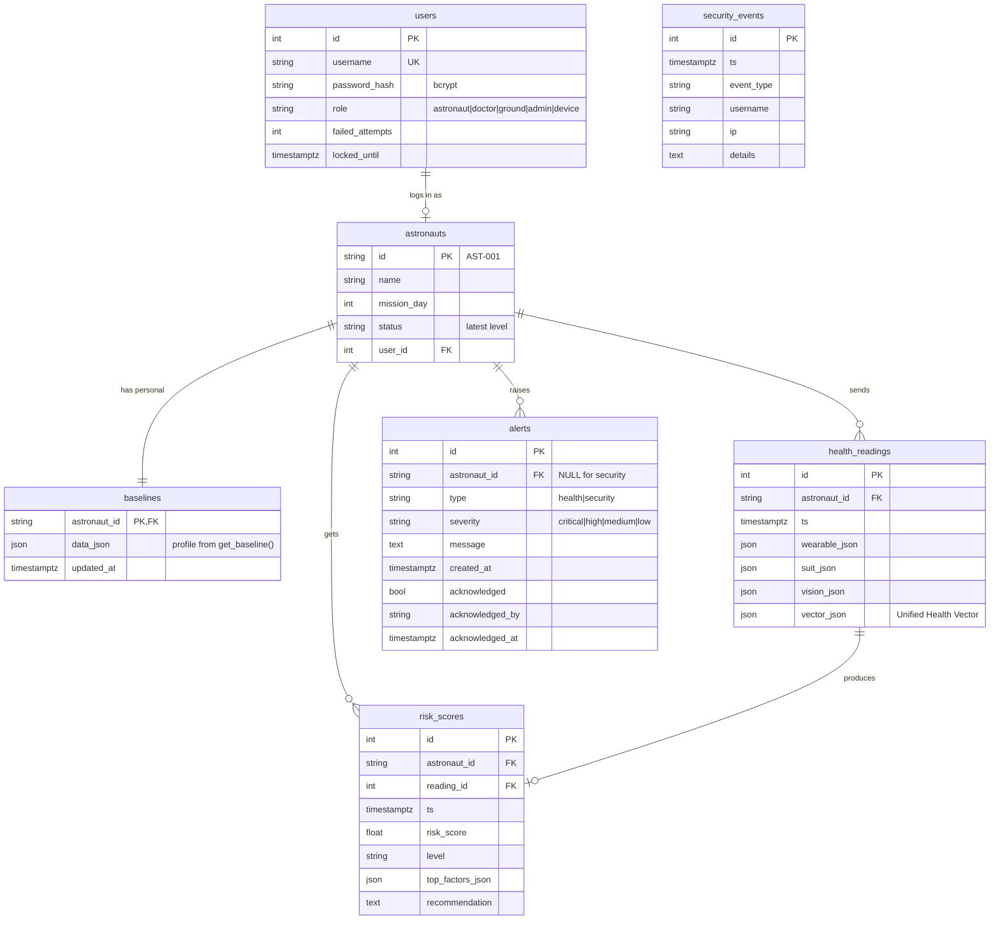

# Database design (ERD)

PostgreSQL in Docker / production, SQLite for the offline Plan B — same models
(`app/models.py`), same migration (`migrations/versions/0001_initial_schema.py`).

## Why it looks like this

- **Raw sensor groups as JSON** (`wearable_json`, `suit_json`, `vision_json`): the three
  sources evolve separately and the AI team may add fields; JSON keeps the schema stable
  while the contract validates every field on the way in.
- **`vector_json`** stores exactly what the risk model saw, so any score can be explained
  and re-computed later (useful for Menna's evaluation and for the demo).
- **`risk_scores` separate from readings**: the dashboard and charts read only this small
  table; `reading_id` links back to the raw data.
- **`baselines` one row per astronaut**: refreshed from `get_baseline()` on startup, so a
  new Digital Twin model is picked up by restarting the API.
- **`security_events`** is an append-only audit log for Marwan's IDS / dashboard;
  `alerts` with `type = security` are the ones a human must look at.

## Columns added beyond the brief

| Table | Column | Reason |
|---|---|---|
| health_readings | vector_json | keep the fused vector (Mariam: "vector is stored") |
| risk_scores | reading_id | trace each score to its reading |
| alerts | acknowledged_by, acknowledged_at | audit for `POST /alerts/{id}/ack` |
| alerts | astronaut_id nullable | security alerts are not about one astronaut |

## Indexes (task 16)

| Index | Serves |
|---|---|
| `health_readings (astronaut_id, ts)` | latest / history per astronaut |
| `risk_scores (astronaut_id, ts)` | `/risk-score`, `/risk-history`, `/crew` |
| `alerts (acknowledged, severity, created_at)` | Emergency-first alert list |
| `alerts (astronaut_id, created_at)` | per-astronaut alerts, de-duplication |
| `security_events (ts)` | latest security events |
| `users (username)` unique | login |
